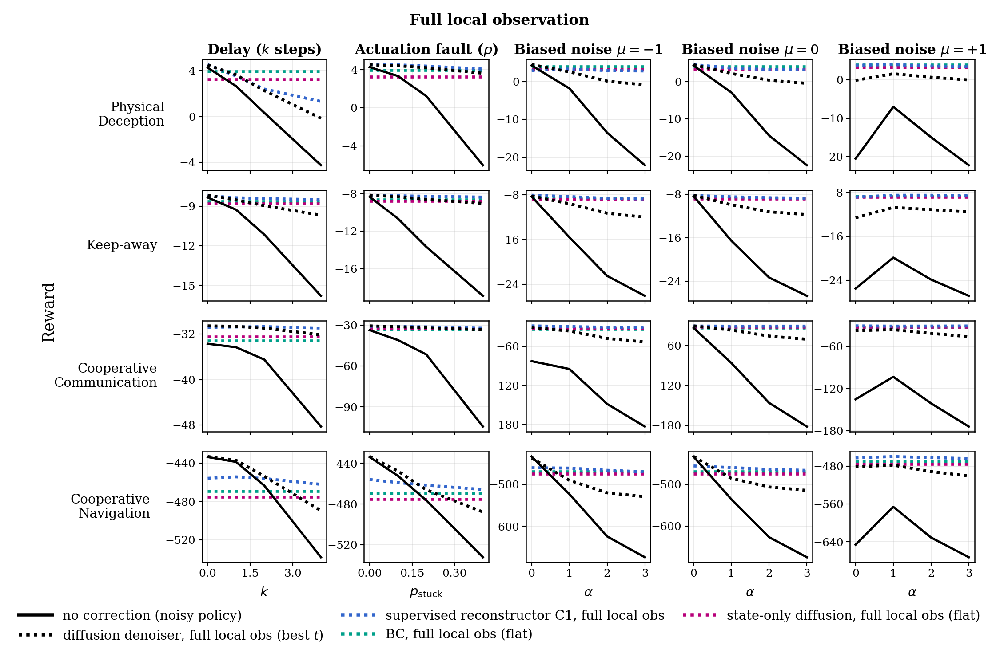
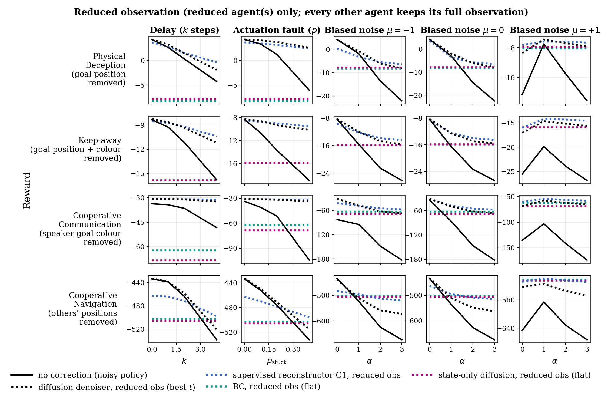

# Decentralized diffusion denoiser and supervised reconstructor: full vs reduced local observation (analysis plot)

Single seed (seed 0), M3DDPG only, 800 episodes per point. This is an analysis plot, not a final figure.
Rewards are summed over agents (the convention of the original plots).

Two figures, same layout, same colour per method. The noisy policy (black, solid) appears in both; every other line is dotted. The denoiser is also black (dotted) because it is applied on top of the noisy policy output.

### Full local observation (every agent's corrector sees its whole local observation)

PDF version: [plots/decentralized_full_obs_all_scenarios.pdf](plots/decentralized_full_obs_all_scenarios.pdf)

### Reduced observation (the reduced agent(s) only; every other agent keeps its full observation)

PDF version: [plots/decentralized_reduced_obs_all_scenarios.pdf](plots/decentralized_reduced_obs_all_scenarios.pdf)

## Key observations (single seed)

- **State-only diffusion is the magenta flat line.** It samples the action from the same diffusion models but starts from pure noise, so it uses only the observation and ignores the faulted action. It is therefore a fault-independent baseline, like BC.
- **With the full observation, the action is nearly predictable from the state alone:** state-only diffusion (magenta, full-observation figure) is close to full-observation BC (teal) and to the clean policy in three of four testbeds (3.24 vs clean 4.25 in Physical Deception, −8.80 vs −8.34 in Keep-away, −32.44 vs −33.69 in Cooperative Communication). In Cooperative Navigation it is lower (−475.18 vs clean −433.83).
- **With the reduced observation, state-only diffusion falls to the reduced-BC level** (magenta vs teal in the reduced figure, e.g. −15.83 vs −15.88 in Keep-away, where the two lines overlap) and the speaker's message accuracy drops to chance (0.33): without the goal, the observation alone cannot recover the target.
- **The reduced-observation denoiser (black dotted, reduced figure) beats reduced state-only in most faulted cells** — 15/17 in Physical Deception, 16/17 in Keep-away and Cooperative Communication — because the noisy action still carries the missing information. In Cooperative Navigation it beats it in only 5/17 cells, and falls below the flat state-only and BC lines under stronger faults.
- **The supervised reconstructor C1 (blue) is the strongest corrector in this screen.** With the full observation it beats the full-observation denoiser in 15/17 (Physical Deception), 17/17 (Keep-away), 16/17 (Cooperative Communication) and 13/17 (Cooperative Navigation) faulted cells, although the denoiser line is the best of 6 variants chosen after the fact and C1 is one fixed variant. With the reduced observation it beats the reduced denoiser in 9/17, 13/17, 15/17 and 12/17 cells.
- **The full-observation C1 line is nearly flat, at about the full-observation BC level** (it stays above BC full in 7, 16, 20 and 19 of 20 cells). With the full observation, C1 mostly ignores the faulted action and acts like a state-based policy. That is why it is robust to every fault, but it is not evidence that it reads the faulted action. In Cooperative Navigation it also costs reward when there is no fault (−455.89 vs clean −433.83).
- **The reduced-observation C1 is where the faulted action matters:** it stays above reduced BC and reduced state-only in most cells (20/20, 19/20, 20/20 and 13/20 above reduced BC), so it does recover part of the missing information from the noisy action.
- Details, numbers and caveats are in the sections below.

## What is plotted

Rows are the four testbeds; columns are the perturbation sweeps (delay `k`, actuation fault `p_stuck`, and Gaussian action noise with std `α` and bias `μ = −1, 0, +1`). **All agents** are faulted and corrected in every panel.

| Line | Colour / style | Full-observation figure | Reduced-observation figure |
|---|---|---|---|
| no correction (noisy policy) | black, solid | the M3DDPG policy with the fault applied and nothing corrected | same (identical values in both figures) |
| diffusion denoiser (best `t`) | black, dotted (same colour as the noisy policy it corrects) | per-agent denoiser on each agent's whole local observation | the reduced agent(s) use the reduced-observation denoiser; every other agent its full-observation denoiser |
| supervised reconstructor C1 | blue, dotted | per-agent C1 on each agent's whole local observation and its faulted action; **all** agents corrected | the reduced agent(s) use the reduced-observation C1; every other agent its full-observation C1 |
| BC (flat) | teal, dotted | BC on the full local observation for **all** agents | the reduced agent(s) act with BC on the reduced input; every other agent is still corrected by its full-observation denoiser |
| state-only diffusion (flat) | magenta, dotted | per-agent diffusion model sampled from pure noise, conditioned on the full local observation only; **all** agents use it | the reduced agent(s) use the reduced-observation state-only diffusion; every other agent its full-observation one |

Where two flat lines have nearly the same value one hides the other (e.g. BC and state-only diffusion in the reduced Keep-away row). The palette was checked for colour-blind separation.

BC and state-only diffusion never see the policy's action, so they are not affected by the fault. Each of these four lines is a single value drawn flat across the panel (BC reduced: its no-fault value; the other three: their one value).
Both C1 lines are a single fixed inference variant (no selection). Both denoiser lines are the best of 6 inference variants per point (`t_start` ∈ {10, 20, 40} × {one-step, chain}), **selected after the fact**.

Row ↔ level shown: Physical Deception = good agents' goal position removed; Keep-away = good agent's goal position and own colour removed; Cooperative Communication = speaker's goal colour removed; Cooperative Navigation = other agents' positions removed.

## Each agent's local observation per testbed, and what the reduced denoiser uses

Indices are 0-based and inclusive (`a-b`). Every agent's action is 5-dimensional (a softmax-like vector over {no-op, left, right, down, up}), except the Cooperative Communication speaker, whose action is a 3-dimensional message.

### Cooperative Communication (`simple_speaker_listener`) — 2 agents, 1 hidden goal
| Agent | Observation (dim) | Fields (indices) | Reduced denoiser uses |
|---|---|---|---|
| Speaker (action: 3-dim message) | 3 | goal colour `0-2` (identifies the target landmark) | **nothing** — the whole observation is dropped; only a constant agent ID remains. The noisy message is its only source of the target. |
| Listener (action: 5-dim move) | 11 | own velocity `0-1`, landmark relative positions `2-7` (3 landmarks), received message `8-10` | full observation (not reduced in the plotted run; dropping the message `8-10` was tested separately) |

### Physical Deception (`simple_adversary`) — 3 agents: 1 adversary, 2 good
| Agent | Observation (dim) | Fields (indices) | Reduced denoiser uses |
|---|---|---|---|
| Adversary | 8 | landmark relative positions `0-3` (2 landmarks), other agents' relative positions `4-7` | full observation (the adversary has no goal field, so nothing to remove) |
| Good agent (×2, shared net) | 10 | goal-landmark relative position `0-1`, landmark relative positions `2-5`, other agents' relative positions `6-9` | `2-9` (8 dims); **drops the goal position `0-1`**. The goal is still one of the two landmark entries but the agent cannot tell which. |

### Keep-away (`simple_push`) — 2 agents: 1 adversary, 1 good
| Agent | Observation (dim) | Fields (indices) | Reduced denoiser uses |
|---|---|---|---|
| Adversary | 8 | own velocity `0-1`, landmark relative positions `2-5`, other agent's relative position `6-7` | full observation (no goal field) |
| Good agent | 19 | own velocity `0-1`, goal relative position `2-3`, **own colour `4-6`** (encodes which landmark is the goal), landmark relative positions `7-10`, landmark colours `11-16` (fixed per landmark, no information), other agent's relative position `17-18` | `0-1, 7-18` (14 dims); **drops goal position `2-3` and own colour `4-6`**. Dropping only the position would leak the goal through the colour. |

### Cooperative Navigation (`simple_spread`) — 3 homogeneous agents (one shared network)
| Agent | Observation (dim) | Fields (indices) | Reduced denoiser uses |
|---|---|---|---|
| Each of the 3 agents | 18 | own velocity `0-1`, own position `2-3`, landmark relative positions `4-9` (3 landmarks), other agents' relative positions `10-13`, communication `14-17` (always zero: all agents silent) | `0-9` (10 dims); **drops other agents' positions `10-13` and the empty comm `14-17`**. The agent sees every landmark but not which ones the others cover. |

Reduced-observation models in the plot only change the agent(s) listed in bold; every other agent in that scenario uses its full-observation per-agent denoiser.

## The models

**Base policy.** M3DDPG (best checkpoint per scenario), executed with its own Gumbel-softmax action sampling. Actions lie in [0, 1]; faults are clipped to the action bounds [−1, 1] before any corrector sees them.

**Training data.** 2000 clean M3DDPG episodes of 25 steps per scenario, split into per-agent (observation, action) pairs (50,000 per agent). Observations and actions are z-scored per agent with statistics from this data.

**Per-agent (decentralized) diffusion denoiser.** One small network per agent type (speaker, listener, adversary, good; Cooperative Navigation has one network shared by its 3 agents with a one-hot agent ID). It sees only the agent's own (possibly reduced) observation, the agent ID, and the agent's own noisy action:
- observation path: Linear(obs+ID → 256) – ReLU – Linear(256 → 256); a time embedding (Linear(1→256)–ReLU–Linear(256→256) of `t/1000`) is added to it; the noisy action (5 or 3 dims) is concatenated and passed through Linear(→256) – ReLU – Linear(256 → action dim), which predicts the noise ε;
- cosine noise schedule (s = 0.008, T = 100, β clipped at 0.999), ε-prediction, trained on clean actions with forward-process noise (Adam, lr 1e-3, batch 1024, 200 epochs, seed 0);
- at test time the faulted action is clipped to [−1, 1], z-scored and scaled by √ᾱ_t, then used as the diffusion state at `t_start` ∈ {10, 20, 40}; the output is either the one-step estimate or the standard DDPM posterior chain down to t = 0, then un-normalised and clipped before being executed.

**Behaviour cloning (BC).** The same backbone without the action and time inputs: from the agent's (reduced or full) observation it regresses the clean action (MSE on z-scored actions, same optimiser, epochs and seed). It is deterministic, has no knowledge of the policy action or the fault, and so gives one flat value per scenario.

**State-only diffusion.** The same per-agent diffusion models as the denoiser (the weights are reused, no retraining: the denoiser is already a conditional diffusion model of the clean action given the observation, trained on clean actions only). Instead of starting the reverse process from the faulted action, it starts from pure noise x₉₉ ~ N(0, I) and runs the full standard DDPM posterior chain from t = 99 to 0, conditioned on the agent's own (full or reduced) observation and ID. The faulted action is never used, so the result is fault-independent (verified: the output is unchanged when a Gaussian or stuck-at fault stream is drawn alongside). It is a generative policy that samples an action from the learned p(action | observation), unlike BC, which outputs a single regressed action.

**Supervised reconstructor (C1).** The same backbone as the denoiser, with the action input but no time input. It is trained with the same data, optimiser, epochs and seed, and with the denoiser's own corruption: x = √ᾱ_t·a + √(1−ᾱ_t)·ε, with t ~ U{0..99} and the S1 cosine schedule. It predicts the normalised clean action in one pass (MSE loss). It never sees the test fault types. At test time it uses the "unscaled" input: the clipped faulted action, z-scored and fed in directly, with no √ᾱ_t scaling and no t. The output is un-normalised and clipped. Eleven models were trained fresh (full: 7, reduced: 4) into `recon_mpe/models/c1_decentral/`.

## Headline numbers (17 faulted cells per level, seed 0)

RESTORES = reduced denoiser beats the noisy policy by > 2 standard errors; BEATS-BC = beats BC on the same reduced input by > 2 standard errors.

| Testbed (reduced level) | RESTORES | BEATS-BC | BC reduced (no-fault value) | BC full obs | state-only diffusion, reduced | state-only diffusion, full | clean |
|---|---|---|---|---|---|---|---|
| Physical Deception (goal position) | 12/17 | 9/17 | −8.17 | 3.94 | −7.74 | 3.24 | 4.25 |
| Keep-away (goal position + colour) | 16/17 | 16/17 | −15.88 | −8.64 | −15.83 | −8.80 | −8.34 |
| Cooperative Communication (speaker goal colour) | 17/17 | 12/17 | −62.22 | −33.15 | −68.24 | −32.44 | −33.69 |
| Cooperative Navigation (others' positions) | 12/17 | 5/17 | −502.24 | −469.41 | −505.37 | −475.18 | −433.83 |

Supervised reconstructor C1 (17 faulted cells; denoiser = best of 6 variants chosen after the fact, C1 = one fixed variant; mean reward over the 17 faulted cells):

| Testbed | C1 full > noisy | C1 full > denoiser full | C1 reduced > noisy | C1 reduced > denoiser reduced | mean: noisy | denoiser full | C1 full | denoiser reduced | C1 reduced | no-fault: C1 full / C1 reduced / clean |
|---|---|---|---|---|---|---|---|---|---|---|
| Physical Deception | 16/17 | 15/17 | 14/17 | 9/17 | −8.26 | 1.67 | 3.34 | −2.54 | −2.59 | 4.52 / 3.66 / 4.25 |
| Keep-away | 17/17 | 17/17 | 16/17 | 13/17 | −18.52 | −10.19 | −8.48 | −12.55 | −12.10 | −8.21 / −8.53 / −8.34 |
| Cooperative Communication | 17/17 | 16/17 | 17/17 | 15/17 | −105.43 | −38.43 | −30.76 | −48.80 | −45.74 | −30.80 / −30.93 / −33.69 |
| Cooperative Navigation | 14/17 | 13/17 | 12/17 | 12/17 | −559.38 | −483.30 | −462.00 | −510.49 | −495.93 | −455.89 / −462.64 / −433.83 |

Counts are raw single-seed comparisons (no significance test).

Cooperative Communication, state-only diffusion: message accuracy 0.99 with the full observation and 0.33 (chance) with the speaker's goal colour removed.

Per-cell results: `decentralized_reduced/summary.txt`. Data behind the plot: `decentralized/` (noisy and full-observation denoiser), `decentralized_reduced/` (reduced denoiser and reduced BC), `decentralized/bc_full/seed0/` (full-observation BC), `decentralized/state_only/seed0/` (state-only diffusion), `decentralized/c1/` (C1, full and reduced; its noisy column was checked equal to the decentralized run in all 80 cells).

## Reading the state-only diffusion lines
- **Full observation:** state-only diffusion lands close to full-observation BC: 3.24 vs 3.94 (Physical Deception), −8.80 vs −8.64 (Keep-away), −32.44 vs −33.15 (Cooperative Communication), −475.18 vs −469.41 (Cooperative Navigation). With the whole observation the clean action is nearly a function of the state, so a model that ignores the action can still act well.
- **Reduced observation:** it falls to about the reduced-BC level in every testbed (−7.74 vs −8.17, −15.83 vs −15.88, −68.24 vs −62.22, −505.37 vs −502.24). The speaker's message accuracy drops to chance (0.33), so without the goal it cannot recover the target from the observation alone.
- **Against the reduced denoiser:** counting the 17 faulted cells, the reduced-observation denoiser (black dotted, reduced figure) is above the reduced-observation state-only line in 15/17 (Physical Deception), 16/17 (Keep-away) and 16/17 (Cooperative Communication), with mean margins of +5.2, +3.3 and +19.5 reward. In Cooperative Navigation it is above in only 5/17 cells (mean −5.1): under stronger faults the reduced denoiser falls below the flat state-only and BC lines there, so for that testbed the noisy action does not add enough beyond the reduced observation. (Single-seed counts, no significance test.)

## Caveats
- One seed, one policy (M3DDPG); no confidence bands. State-only diffusion samples stochastically, so its single value carries sampling noise; the flat lines are one 800-episode run each.
- "Best t" is chosen per point after the fact, for both denoiser lines.
- The Cooperative Communication row shows the speaker-reduced level; the listener (message removed) level is in `decentralized_reduced/simple_speaker_listener__listener__removed/`.
- The Kalman filter is not included in this plot; the supervised reconstructor shown is C1 only (unscaled input), not C2 (the Gaussian-trained one).
- The C1 vs denoiser comparison favours the denoiser in selection (best of 6 after the fact) and still goes to C1; one seed, so the size of the gap is not established.
